# WinDock

[Português](#português) · [English](#english)

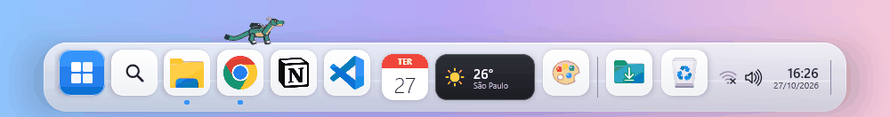

---

## Português

WinDock é uma barra de tarefas personalizada para Windows 10/11, feita com Kotlin e Compose Multiplatform. Ela substitui a barra nativa e mantém o que você já usa: apps fixados, janelas abertas, pesquisa, relógio, bateria, volume, clima e controle de música.

### Destaques

- Temas animados (Halloween, outono, Natal), além de Casual, Escuro, Flutuante e Vidro
- Mascotes que andam pela barra e param para fazer algo: gato, cachorro, onça, dragão ocidental e dragão oriental
- Prévia das janelas ao passar o mouse, menu de botão direito com as listas de atalhos do Windows
- Pesquisa de apps e configurações, fixar e desafixar apps, mostrar a área de trabalho
- Tema **Sistema**: devolve a barra de tarefas padrão do Windows com um clique

### Download

Baixe o instalador **WinDock-1.0.0.msi** em [Releases](https://github.com/arthurriosprogramador/win-dock/releases/latest). A instalação é por usuário, sem pedir administrador. O instalador não é assinado, então o Windows pode mostrar o aviso do SmartScreen: clique em **Mais informações → Executar assim mesmo**.

### Como rodar o código

Requisitos: Windows 10 (2004+) ou 11 e JDK 17 ou mais novo.

```
./gradlew :composeApp:run
```

Na tela de personalização, escolha um tema e clique em **Aplicar no Windows**. Para voltar à barra normal, escolha o tema **Sistema**.

Instalador (MSI): `./gradlew :composeApp:packageMsi`

---

## English

WinDock is a custom taskbar for Windows 10/11, built with Kotlin and Compose Multiplatform. It replaces the native taskbar and keeps what you already use: pinned apps, open windows, search, clock, battery, volume, weather and media controls.

### Highlights

- Animated themes (Halloween, autumn, Christmas), plus Casual, Dark, Floating and Glass
- Mascots that walk along the bar and stop to do something: cat, dog, jaguar, western dragon and eastern dragon
- Window previews on hover, right-click menu with Windows jump lists
- App and settings search, pin and unpin apps, show desktop
- **System** theme: gives the standard Windows taskbar back in one click

### Download

Get the **WinDock-1.0.0.msi** installer from [Releases](https://github.com/arthurriosprogramador/win-dock/releases/latest). It installs per user, with no administrator prompt. The installer isn't code-signed, so Windows may show a SmartScreen warning: click **More info → Run anyway**.

### Running from source

Requirements: Windows 10 (2004+) or 11 and JDK 17 or newer.

```
./gradlew :composeApp:run
```

In the settings window, pick a theme and click **Aplicar no Windows** (apply to Windows). To go back to the normal taskbar, pick the **Sistema** (System) theme.

Installer (MSI): `./gradlew :composeApp:packageMsi`

---

## Temas · Themes

| | |
|---|---|
| **Casual**<br>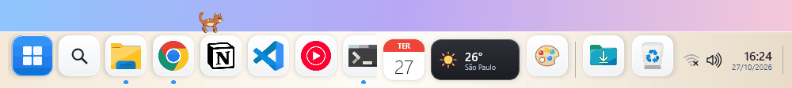 | **Escuro · Dark**<br>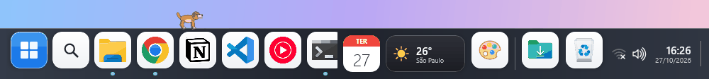 |
| **Flutuante · Floating**<br>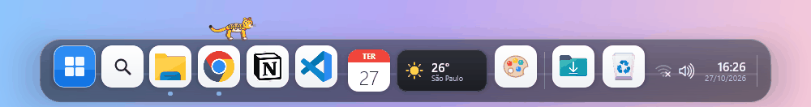 | **Vidro · Glass**<br> |
| **Halloween · Fantasma / Ghost**<br>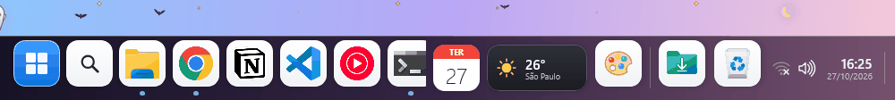 | **Halloween · Zumbis / Zombies**<br>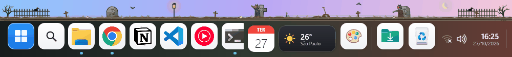 |
| **Halloween · Doces ou travessuras / Trick or treat**<br>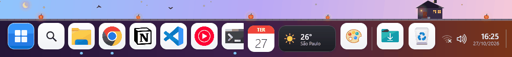 | **Outono · Autumn**<br>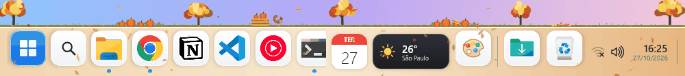 |
| **Natal · Boneco de neve / Snowman**<br>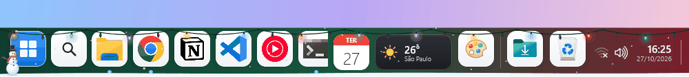 | **Natal · Oficina do Papai Noel / Santa's workshop**<br>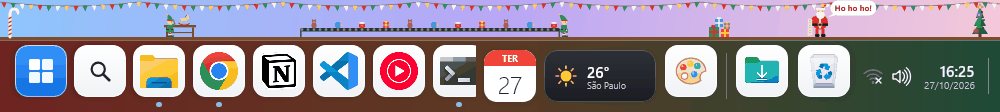 |
| **Natal · Casa aconchegante / Cozy home**<br>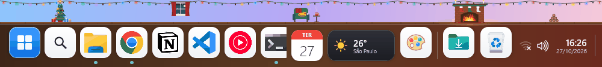 | |

## Mascotes · Mascots

| | |
|---|---|
| **Gato · Cat**<br>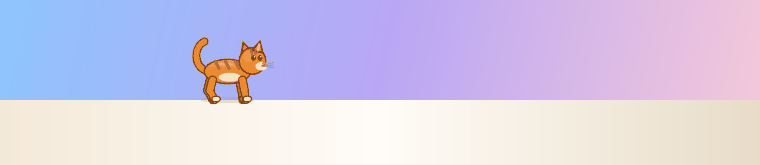 | **Cachorro · Dog**<br>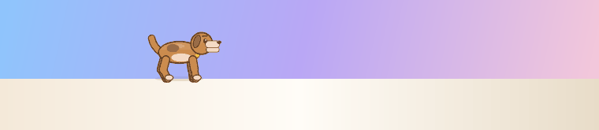 |
| **Onça · Jaguar**<br>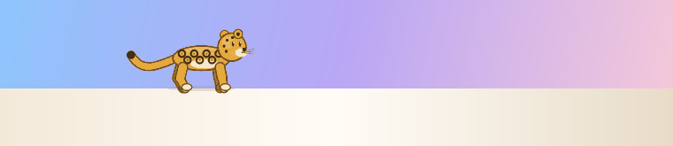 | **Dragão ocidental · Western dragon**<br>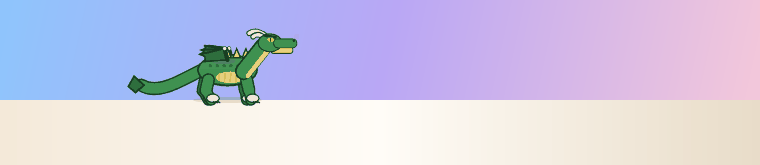 |
| **Dragão oriental · Eastern dragon**<br>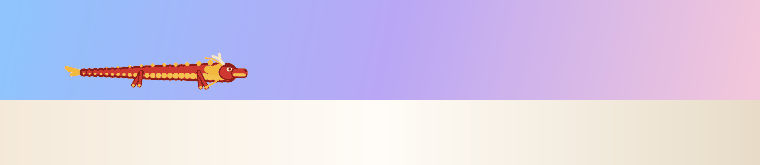 | |
